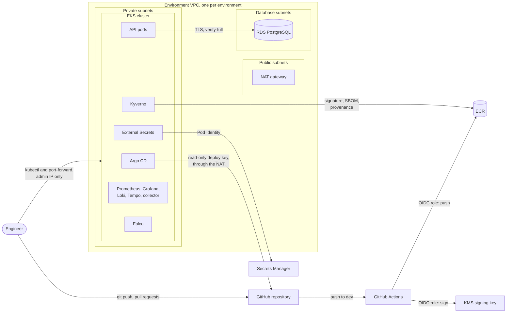
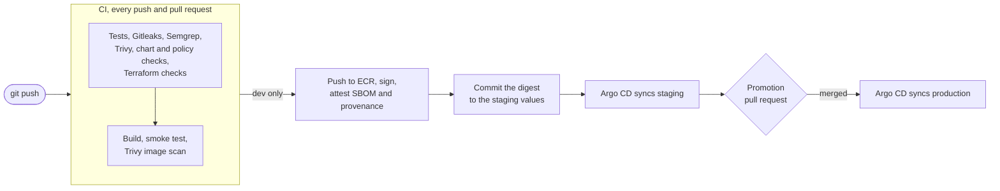

# Secure EKS GitOps Platform

A Kubernetes platform on AWS that runs a small NestJS API in two EKS clusters, staging and production, and only lets in images it can trace back to its own CI. GitHub Actions tests and scans every commit, then pushes the image to ECR and signs it, along with its SBOM and provenance, using a KMS key. Argo CD deploys from Git, production only changes through a pull request, and Kyverno checks the signature again before any pod starts. The infrastructure is Terraform, and every check below was triggered on purpose at least once.


## Stack

- API: NestJS on Node.js 24 with PostgreSQL 17, instrumented with OpenTelemetry
- CI: GitHub Actions with OIDC to AWS, Gitleaks, Semgrep, Trivy, Checkov, TFLint, the Kyverno CLI and promtool, every tool pinned by digest or checksum
- Supply chain: cosign with a KMS key, CycloneDX SBOM and SLSA provenance as signed attestations, Renovate
- Kubernetes: EKS 1.35, Helm, Argo CD, Kyverno, Pod Security Standards, NetworkPolicies, External Secrets, EKS Pod Identity and Falco
- Observability: Prometheus, Alertmanager, Grafana, Loki, Tempo and the OpenTelemetry Collector
- Infrastructure: Terraform with remote state in S3, on AWS VPC, EKS, RDS, ECR, KMS and Secrets Manager

## Architecture

Each environment is its own VPC and EKS cluster, built from the same Terraform module. Nodes and pods sit in private subnets behind a NAT gateway, and RDS sits in database subnets with no route to the internet. Nothing has a public address except the cluster's API endpoint, which only answers my IP. There's no load balancer: I reach the API, Argo CD and Grafana with `kubectl port-forward`.

CI never talks to a cluster. Argo CD runs inside each one and pulls from the repository with a read-only deploy key, so the only way to change what runs is a commit. [docs/architecture.md](docs/architecture.md) has the details.

<details>
<summary>The architecture as a Mermaid diagram</summary>



</details>

## How a change ships



1. Every push and pull request runs the checks above. Any failure stops the build.
2. On `dev`, a separate job logs in to AWS with OIDC, pushes the exact image that was scanned, and signs it and its attestations.
3. A commit sets the new tag and digest in `environments/staging/api.yaml`. Argo CD syncs it, and Kyverno verifies the image before the pods start.
4. `scripts/promote.sh` opens a pull request that copies the staging tag and digest to production. A CI check fails it if staging never ran that image.
5. Merging is the approval. Rolling back is reverting the pull request.

## Failures tested on purpose

| What was broken | What caught it |
|---|---|
| An unsigned image, one without an SBOM, and a copy in another account's registry | [Kyverno at admission](docs/evidence/signed-images-at-admission.md) |
| A production pull request with an image staging never ran | [The promotion check in CI](docs/evidence/promotion-and-rollback.md) |
| A pull request widening CI's AWS trust to any branch | [A custom Checkov rule, and AWS itself](docs/evidence/github-oidc.md) |
| Public access opened on the Terraform state bucket | [Checkov](docs/evidence/terraform-ci-gates.md) |
| A manual `kubectl scale` in production | [Argo CD self-heal](docs/evidence/drift-self-heal.md) |
| Staging asking for production's database password | [IAM, through Pod Identity](docs/evidence/secrets-across-environments.md) |
| A database outage | [Alerts, then logs and a trace](docs/evidence/alerts-and-drill.md) |
| An attacker reading `/etc/shadow` and hunting for AWS keys in a container | [Falco and an alert](docs/evidence/falco-runtime-detection.md) |
| A debug container with an unapproved image | [A new Kyverno policy, after the bypass worked](docs/evidence/admission-and-rbac-review.md) |

## Security

Nothing uses a stored key. People sign in through SSO, CI gets a one-hour role through GitHub's OIDC token that only works for pushes to `dev`, and each pod that calls AWS gets a Pod Identity role scoped to its service account. Terraform generates the database passwords without writing them to its state, and External Secrets copies them from Secrets Manager into the cluster.

The environment namespaces enforce the `restricted` Pod Security level and deny all traffic by default. Kyverno only admits the API image pinned to a commit and a digest and signed by CI, Argo CD projects limit what each application may deploy, and Falco watches system calls on every node. The [threat model](docs/threat-model.md) goes through each threat, the control that covers it, and the risks accepted on purpose.

## Design choices

- EKS instead of ECS, to use the Kubernetes-native controls. My previous project ran the same API on ECS Fargate, which is the better fit for a single service.
- Two clusters from one module. Staging runs on spot nodes, production on on-demand, because a spot interruption there would take half of the API down.
- Argo CD pulls instead of CI pushing, so CI has no cluster credentials. Environments are folders, not branches.
- Promotion copies the tag and the digest, so production runs the bytes staging ran, checked twice: in Git by CI, and in the cluster by Kyverno.
- cosign with a KMS key instead of keyless signing, because GitHub's attestations need a public repository on the free plan and Rekor is a public log. The provenance is honest about being SLSA Build L1.
- The registry address stays out of Git because it contains the account ID. A Kyverno policy adds it when a pod is created.
- Renovate instead of Dependabot, which doesn't understand chart versions in Argo CD applications.
- Both environments are created and destroyed around each working session. Staging costs about 0.30 USD/h and production about 0.40 USD/h.

## What would change in production

- Separate AWS accounts for staging and production
- Branch protection with required checks, which needs a public repository or a paid plan
- Keyless signing and GitHub's attestations, so the provenance doesn't come from my own workflow
- An ingress with ACM and a WAF, and a private-only cluster endpoint
- SSO for Argo CD and Grafana, and an Alertmanager receiver that pages someone
- Loki and Tempo on S3, Multi-AZ RDS with deletion protection, and a NAT gateway per zone

## Running it

Locally:

```bash
cp .env.example .env
docker compose up --build
curl http://127.0.0.1:3000/health
```

`scripts/kind-up.sh` runs the API on a local kind cluster. On AWS, apply `infra/bootstrap` and `infra/shared` once, then `./scripts/eks-up.sh staging` creates an environment in 20 to 30 minutes and `./scripts/eks-down.sh staging` removes it. The [deployment guide](docs/deployment.md) has the exact steps, promotion, rollback and costs.

## Repository

```text
app/            NestJS API, tests, Dockerfile and migrations
charts/         Helm charts: api, baseline (namespace guardrails and policies), postgres (kind only)
environments/   Values per environment, including the image each one runs
argocd/         Argo CD values, bootstrap per cluster, applications and projects
infra/          Terraform: bootstrap, shared, the environment module, staging and production
observability/  Monitoring stack values and dashboards
falco/          Falco values, tuning and alert rules
tests/alerts/   promtool unit tests for the alert rules
checkov/        Custom Checkov rule for OIDC trust policies
scripts/        eks-up, eks-down, promote and the kind lab
docs/           Architecture, threat model, deployment guide and evidence
```

## Status

A practice project, last updated on October 19, 2026. It isn't maintained, so the pinned versions and image digests will fall behind and new vulnerabilities will show up over time; update them before reusing any of it. The clusters only existed during working sessions, so there is no live endpoint.

AI assistants sped up the writing, the same way they do in my day-to-day work. The decisions and trade-offs were mine, and I can explain what any part of this does and why.
