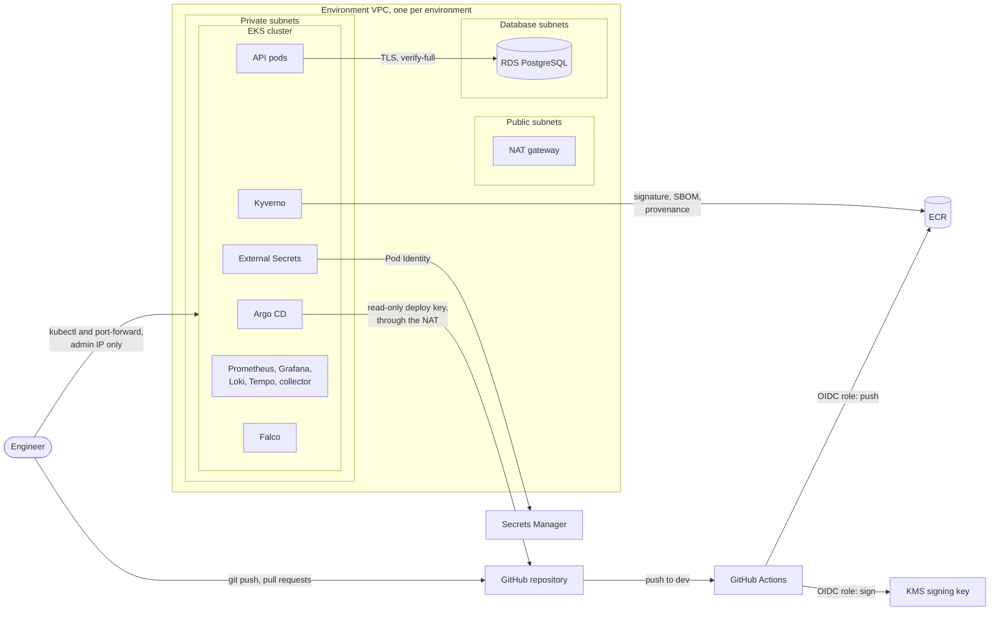
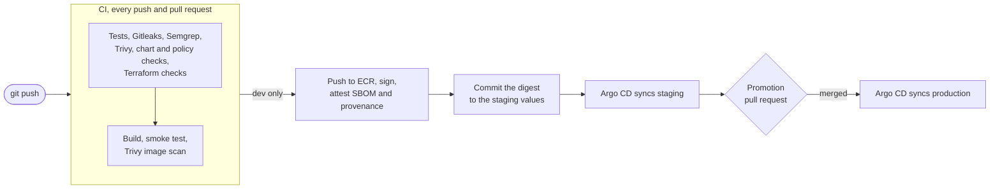

# Architecture

The API runs in two EKS clusters, staging and production, each in its own VPC. GitHub Actions builds, scans and signs the image but never touches a cluster. Argo CD runs inside each cluster and pulls whatever Git says should run.

## Infrastructure

The Terraform is split by how long things live. `infra/bootstrap` holds the state bucket and is created once. `infra/shared` holds what both environments use: the ECR repository, the cosign signing key, the role CI assumes and a few KMS keys. It costs about 2 to 3 USD a month. `infra/staging` and `infra/production` each call the same module, `infra/modules/environment`, and I create and destroy them every working session. The only differences are the name, the address range and the nodes: spot instances for staging, on-demand `t3.large` for production.

I wrote the module with plain AWS resources instead of the community EKS and VPC modules. It's more code, but Checkov can scan all of it, and I know what every line does.

Each VPC spans two availability zones. The nodes and pods sit in private subnets and go out through a single NAT gateway, because Argo CD needs GitHub and the charts pull images from public registries. RDS sits in its own subnets with no route to the internet. There's no load balancer, and VPC flow logs record every connection.

The clusters run Kubernetes 1.35. The API endpoint only answers my IP address, my SSO role is the only admin (through an EKS access entry), and Kubernetes Secrets are encrypted with a KMS key. Pods can't reach the node's instance metadata, so they can't borrow its IAM role. One thing I only caught by testing: the VPC CNI silently ignores NetworkPolicies until you turn that feature on.

## From commit to cluster

The job that builds the image runs code downloaded by npm, so it never gets AWS credentials. A separate publish job, which only runs on pushes to `dev`, takes the exact tarball that was scanned, pushes it to ECR and signs it with the KMS key. The SBOM and the provenance are attached as signed attestations, and the job verifies all three against the public key in the repo before it finishes.

Argo CD watches the `dev` branch. Environments are folders, not branches: `environments/staging` and `environments/production` hold the values each one gets, including the image digest. Self-heal is on, so a manual change in the cluster gets put back within seconds. Every app belongs to an Argo CD project that limits what it can deploy and where, and the catch-all `default` project allows nothing.

Deploying to staging is a commit. Production only changes through a pull request that copies the staging digest, and rolling back is reverting that pull request.

## Inside the cluster

The `staging` and `production` namespaces enforce the `restricted` Pod Security level: no root, no privilege escalation, no Linux capabilities. They also deny all network traffic by default, and the API can only reach its database and the trace collector. Apart from `kube-system`, only two namespaces allow privileged pods: one for Falco and one for the node agents (the log collector and the node exporter), because they read from the nodes themselves.

Kyverno checks every pod in those namespaces before it starts:

- only the API image is allowed, pinned to a commit and a digest
- that image must be signed with the CI's key and carry a signed SBOM and a signed provenance from this repo's `dev` branch
- containers added with `kubectl debug` follow the same rules
- the ECR address gets filled in at runtime, so the account ID never lands in Git

Kyverno runs three replicas, because its policies fail closed: if it went down, no new pod could start.

Nothing uses an access key. People sign in through SSO, CI uses GitHub's OIDC token, and every pod that talks to AWS gets its own Pod Identity role, valid only for its service account, namespace and cluster. Kyverno can only read the API images, and External Secrets can only read its own environment's two database secrets.

## Database and secrets

Each environment has RDS PostgreSQL 17 with encrypted storage and no public address. The server refuses connections without TLS, and the API checks the server's certificate. Terraform generates the passwords during the apply without ever writing them to its state, Secrets Manager keeps them, and External Secrets copies them into the cluster. The API logs in as a role that owns its tables but can't administer anything.

## Observability and runtime detection

The API sends traces and logs through the OpenTelemetry Collector to Tempo and Loki, and exposes metrics for Prometheus. Grafana has a dashboard for it, kept as JSON in the repo. The alert rules have unit tests in CI, so a broken threshold fails a pull request. Alertmanager has no receiver yet, so nothing pages anyone.

Falco watches system calls on every node and alerts on things like reading `/etc/shadow` or searching for AWS keys. I tuned it so the controllers that talk to the Kubernetes API by design don't flood it, and added a stricter rule for the environment namespaces.

Renovate keeps every pinned version current: npm packages, images, GitHub Actions, Helm charts and Terraform providers. A new version has to be a week old, and major versions wait for my approval.
