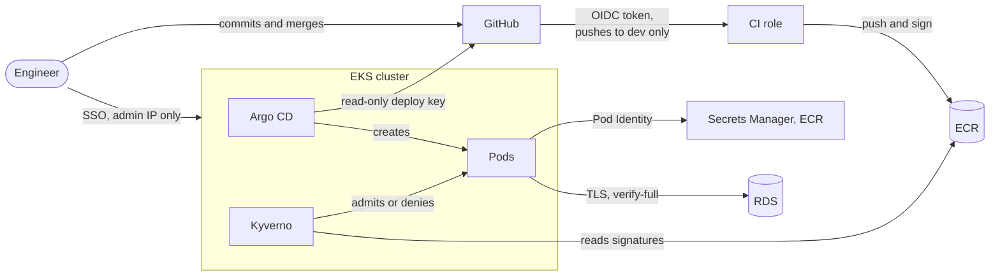

# Threat model

What could go wrong in this setup, what stops it, and what's still exposed. It covers the CI workflow, the shared AWS resources and the two EKS environments.

## What I'm protecting

- The repository, because the workflow and the environment values decide what CI does and what each cluster runs
- The CI role and the KMS signing key, because anything signed with that key passes the cluster's checks
- The images in ECR, which are the exact code each environment runs
- The clusters, the database and its passwords
- The Terraform state and access to the AWS account

## Where trust changes hands

Whatever reaches `dev` runs in staging, and production only changes through a pull request. CI gets AWS credentials only for pushes to `dev`, and it has no access to any cluster. Inside the clusters, Kyverno checks every image before it runs, and each pod that calls AWS has a role scoped to that pod alone. People only get in through SSO, from my IP.

The only public thing is each cluster's API endpoint, and it only answers my IP. Everything else is reached through `kubectl port-forward`.

## Threats and controls

| Threat | What stops it | What's still left |
|---|---|---|
| A secret gets committed | Gitleaks on every push, Trivy on the image, and database passwords generated outside Git and the Terraform state | A leaked secret still has to be rotated |
| Someone abuses CI's AWS access | No stored keys. The OIDC trust only accepts pushes to `dev`, the build job never gets credentials, and the role can only push and sign one repository | Anyone who can push to `dev` can get an image signed |
| An image CI didn't build runs in a cluster | Kyverno requires our signature, SBOM and provenance, also for debug containers, and fails closed | The provenance comes from my own workflow (SLSA Build L1), and there's no public transparency log |
| Production gets an untested image | The promotion pull request copies the staging digest, CI checks it, and Kyverno checks it again | A private repo on the free plan can't require checks before merging |
| Someone changes a cluster by hand | Argo CD self-heal, only my SSO role is admin, and the API endpoint only answers my IP | An admin can pause self-heal |
| A container gets compromised | Pod Security `restricted`, read-only filesystem, no service account token, no access to node metadata, and Falco alerts | Falco detects but doesn't block, and alerts don't page anyone yet |
| An attacker moves around inside the cluster | Default-deny network policies, and the API can only reach its database and the trace collector | The platform namespaces have no network policies, so the database login is the last barrier there |
| One environment reads another's secrets | Separate clusters, and each Pod Identity role can only read its own environment's secrets | Both environments share one AWS account |
| A vulnerable or malicious dependency | Lock files, a 7-day minimum release age, Trivy, Semgrep, pinned digests and Renovate | Trivy can't see the Node.js runtime inside the distroless image |
| An insecure infrastructure change | Format, validate, TFLint and Checkov on every push, and I read every plan before applying. CI never applies | Applies run from my laptop with admin rights |

## Accepted on purpose

- The API has no authentication. It's the payload of the platform, not a product.
- No load balancer, TLS ingress or WAF, because there's no domain and the clusters only exist during working sessions.
- RDS in a single availability zone with one day of backups, and one NAT gateway per VPC.
- Argo CD and Grafana use local admin accounts instead of SSO.
- External Secrets has cluster-wide permissions. It could be scoped to each environment's namespace.

The [README](../README.md#what-would-change-in-production) lists what would change for a real production setup.
